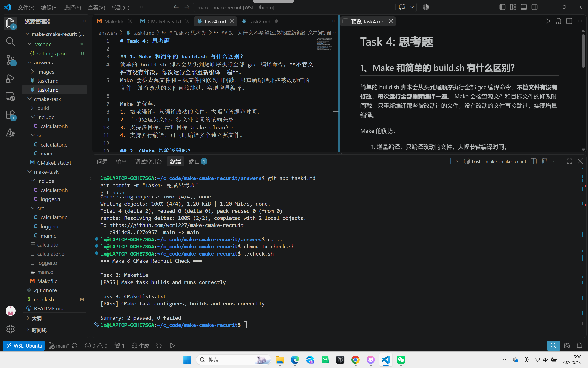

# Task 4: 思考题

## 1、Make 和简单的 build.sh 有什么区别？
简单的 build.sh 脚本会从头到尾顺序执行全部 gcc 编译命令，**不管文件有没有修改，每次运行全部重新编译一遍**
Make 会检查源文件和目标文件的修改时间，只重新编译那些被改动过的文件，没有改动的文件直接跳过，实现增量编译

Make 的优势：
1. 增量编译，只编译改动的文件，大幅节省编译时间
2. 自动处理头文件、源文件之间的依赖关系
3. 支持多目标、清理目标（make clean）
4. 支持并行编译，可同时编译多个独立源文件

## 2、CMake 是编译器吗？

CMake **不是编译器**，它是构建系统生成工具，只用来生成 Makefile / Ninja 等构建脚本，本身不做代码编译

执行 `cmake --build build`，CMake 调用底层构建工具(make/ninja)，**真正把C源代码翻译成机器码的是 gcc（C语言编译器）**

## 3、为什么不希望每次都重新编译所有 `.c` 文件？
项目有50个.c文件，仅修改其中一个，其余49个文件内容完全没变，它们编译出来的目标文件(.o)依旧可用
全部重新编译属于无效重复工作，会浪费大量CPU时间，项目规模越大，全量编译耗时越长，降低开发调试效率
只编译改动的那一个文件，再做链接，就可以得到新的可执行程序
## 自检脚本运行结果

## .c、.o 和最终可执行文件分别是什么？
.c 文件 —— 源代码\
人类可读的文本文件，用 C 语言书写，计算机不能直接执行\
.o 文件 —— 目标文件\
由 .c 经过编译生成的二进制文件\
可执行文件\
由多个 .o 经过链接生成，里面是完整的、可直接加载运行的程序
## 编译和链接有什么区别？
预处理：展开 #include、处理 #define 宏、条件编译\
编译：把 C 代码翻译成汇编\
汇编：把汇编翻译成机器码（.o）\
链接：把多个 .o 可链接成执行文件
## 为什么 Make 能做到增量构建？
Make 会比较"目标"和"依赖"的时间\
件系统记录每个文件的修改时间（mtime）\
如果 .c 或 .h 在你上次编译之后没被改过，它的 mtime 就比 .o 早 → 不用重编\
如果改过 → mtime 比 .o 新 → 重编
## CMake 是编译器吗？
CMake 不编译任何代码\
它读 CMakeLists.txt，生成另一个构建系统所需的文件：\
Linux 上默认生成 Makefile（配合 make）\
也可生成 Ninja 文件、Visual Studio 工程、Xcode 工程等
## CMakeLists.txt 最后怎么变成可运行程序？
编译把每个 .c 翻成 .o，链接把 .o 拼成程序
Make 靠时间戳做增量，CMake 生成脚本
真正干活的始终是 gcc 这类编译器
